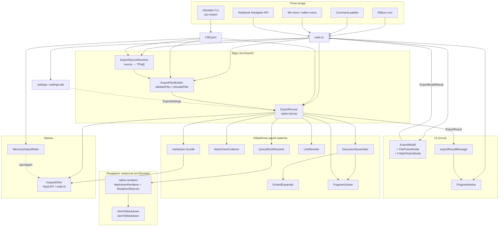
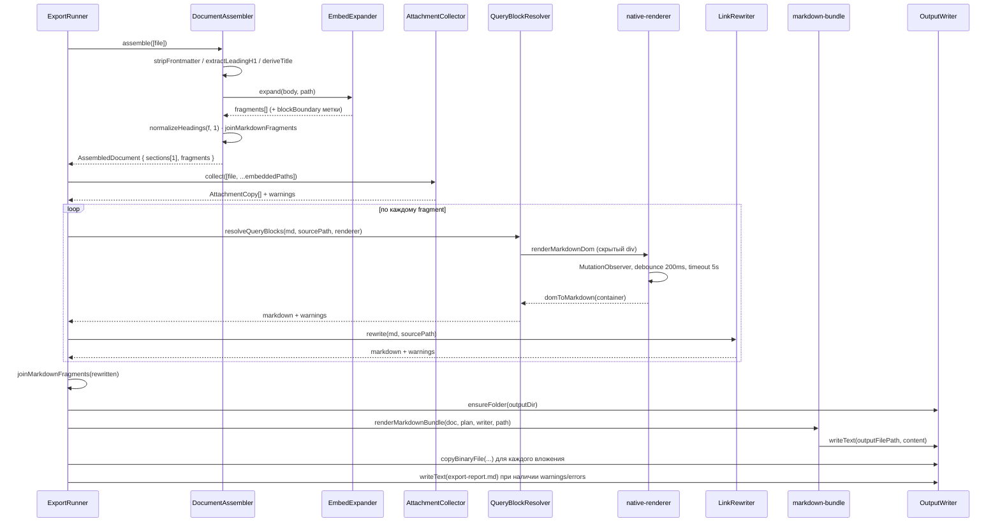

# Ревью проекта azz-page-export — 2026-09-20

Контекст: после коммита `067f169` остался единственный формат экспорта — Markdown с отрендеренными
результатами запросов (mdr). Цель ревью — найти избыточность, оставшуюся от многоформатной архитектуры,
и предложить упрощения. **Изменения в код не вносились.**

Объём: 3 880 строк продакшн-кода, 4 868 строк тестов (25 файлов, 389 тестов — все проходят).

---

## 1. Схема взаимодействия компонентов

### 1.1. Общая картина



### 1.2. Конвейер обработки одной заметки (ExportRunner, шаги 1–6)



### 1.3. Что важно понимать в этой схеме

* **`ExportRunner` — единственный оркестратор.** Все модули `src/export/*` — это его пассивные
  helper-ы; между собой они почти не общаются (исключения: `DocumentAssembler → EmbedExpander`,
  `QueryBlockResolver → native-renderer → HtmlToMarkdown`).
* **`main.ts` и `CliExport.ts` дублируют одну и ту же цепочку** resolver → plan → validate → runner.
* **Рендеринг запросов требует живого DOM Obsidian** (`activeDocument`), поэтому подменяется через
  `ExportRunOptions.queryRenderer` в тестах и отсутствует в headless-сценариях.

---

## 2. Главная находка: остаточная многосекционность

Это корень большей части лишней сложности.

`DocumentAssembler.assemble(files: TFile[], title?: string)` спроектирован под склейку **нескольких**
заметок в один документ (наследие PDF/DOCX/EPUB, где батч сливался в один файл). Но
`ExportRunner` вызывает его ровно так ([ExportRunner.ts:145](src/export/ExportRunner.ts:145)):

```ts
const doc = await assembler.assemble([file]);
```

— всегда с **одним** файлом, внутри цикла по файлам. Следствия:

| Сущность | Фактическое состояние |
|---|---|
| `AssembledDocument.sections` | всегда длины 1 |
| `AssembledDocument.title` | всегда `=== sections[0].title` |
| Параметр `title` в `assemble()` | никогда не передаётся |
| `isSingleSection` в [markdown-bundle.ts:22](src/formats/markdown-bundle.ts:22) | всегда `true` |
| Ветка `parts.push('## ' + section.title)` | **недостижима** |
| Цикл `for (const section of doc.sections)` | всегда одна итерация (в 3 местах) |

**Предложение.** Свернуть `AssembledDocument` + `DocumentSection` в один плоский тип:

```ts
export type ExportedNote = {
	sourcePath: string;
	title: string;
	propertiesBlock: string | null;
	fragments: NoteFragment[];
	attachments: AttachmentCopy[];
	warnings: string[];
	embeddedPaths: string[];
};
```

и заменить `assemble(files[])` на `assemble(file): Promise<ExportedNote>`. Уходят два типа из
`types.ts`, три цикла в `ExportRunner`, вся ветвистость `markdown-bundle`.

---

## 3. Баг, порождённый этой избыточностью: `includeSourcePathComments` не работает

`DocumentAssembler.buildSection` кладёт комментарий в `section.markdown`
([DocumentAssembler.ts:83-85](src/export/DocumentAssembler.ts:83)):

```ts
const markdown = this.includeSourcePaths
	? `<!-- source: ${file.path} -->\n${joined}`
	: joined;
```

но `ExportRunner` потом **перезаписывает** `section.markdown`, пересобирая его из `section.fragments`
([ExportRunner.ts:210](src/export/ExportRunner.ts:210)):

```ts
section.markdown = joinMarkdownFragments(rewritten);
```

Комментарий теряется. Проверено эмпирически: с `includeSourcePathComments: true` экспорт заметки
`Note.md` даёт `# Note\n\nHello\n` — без `<!-- source: Note.md -->`.

Настройка при этом описана в README (строка 86) и в UI настроек как рабочая. Тестами не покрыта.

**Причина** — двойная сборка: ассемблер склеивает фрагменты, но результат склейки никем не
используется; рантаймер разбирает `fragments` заново и склеивает второй раз. `section.markdown`
на выходе ассемблера — мёртвое поле.

**Предложение.** `ExportedNote` не хранит собранный markdown вообще — только `fragments`. Сборка
происходит один раз, в конце, в `ExportRunner`. Комментарий источника добавляется там же, при
финальной сборке.

---

## 4. `normalizeHeadings(f.markdown, 1)` — тождественная функция

[DocumentAssembler.ts:79](src/export/DocumentAssembler.ts:79) — единственный вызов в проде:

```ts
markdown: normalizeHeadings(f.markdown, 1),
```

Внутри: `newLevel = Math.min(currentLevel + minLevel - 1, 6)`. При `minLevel = 1` это
`newLevel = currentLevel` — функция построчно разбирает markdown, отслеживает code fences и
возвращает **ровно тот же текст**. Сдвиг заголовков был нужен, когда заметки сливались под общий
`# Title`; сейчас каждая заметка — отдельный файл.

30 строк кода + 5 тестов можно удалить.

---

## 5. `src/formats/` больше не про форматы

Каталог назван во множественном числе и описан в CLAUDE.md как «Output renderers», но содержит
два файла, ни один из которых не является альтернативным форматом:

* `markdown-bundle.ts` — единственный и обязательный вывод;
* `native-renderer.ts` — инфраструктура рендеринга DOM, нужная только `QueryBlockResolver`.

К тому же `renderMarkdownBundle` — не чистая функция рендеринга, а смесь:

* принимает `plan` только ради `await writer.ensureFolder(plan.outputRoot)` — что **дублирует**
  `ensureFolder(outputDir)`, уже выполненный в ExportRunner шагом раньше;
* сама пишет файл через `writer.writeText`;
* возвращает `string[]` warnings, который **всегда пустой** (`const warnings = []; … return warnings`).

**Предложение:**

```ts
// src/export/composeOutput.ts
export function composeOutput(note: ExportedNote, includeProperties: boolean): string
```

— чистая функция строка→строка, запись остаётся в `ExportRunner`. `native-renderer.ts` переезжает в
`src/export/` рядом с `QueryBlockResolver`. Каталог `src/formats/` исчезает.

---

## 6. `ExportRunner.run()` — 230 строк, 6 зон ответственности

Метод делает: preflight-проверки → релокацию плана при коллизии → цикл по файлам (6 шагов) →
копирование вложений с дедупликацией → учёт отмены и «незавершённых» путей → расчёт статуса →
запись отчёта. Плюс внутри — `runLoop:` labeled break, три вида `if (this.cancelled) break`,
и повторяющееся условие `isSingleFile ? SINGLE_FILE_PHASES[n] : \`... ${file.basename}\`` пять раз.

**Предложение — разрезать по существующим швам:**

```
ExportRunner.run()
  ├─ preflight(plan, writer)            → { files, errors } | Failure
  ├─ resolveEffectivePlan(...)          → перенести в ExportPlan.ts (там уже живёт relocatePlan)
  ├─ exportNote(file, ctx)              → шаги 1–6 для одной заметки, возвращает NoteOutcome
  ├─ copyAttachments(attachments, ctx)  → отдельно, с дедупликацией
  └─ writeReport(status, outcome, ctx)  → перенести в ExportReport.ts
```

Побочный эффект: `phaseLabel(step, isSingleFile, basename)` вместо пяти тернарников.

---

## 7. Мелкие и средние замечания

### 7.1. Мёртвый код

| Что | Где | Комментарий |
|---|---|---|
| `summarizePlan()` | [ExportPlan.ts:136](src/export/ExportPlan.ts:136) | вызывается только из своего теста |
| `OutputWriter.isFolderEmpty()` | [OutputWriter.ts:116](src/export/OutputWriter.ts:116) | не вызывается нигде, включая тесты |
| `utils.containsTraversal()` | [utils.ts:11](src/export/utils.ts:11) | только тест; `validatePlan` реализует ту же проверку инлайном |
| `normalizeHeadings()` | см. §4 | тождественна при текущем использовании |
| `ExportSource.folder.recursive` | [types.ts:13](src/types.ts:13) | `ExportModal` всегда ставит `true`; `false` нигде не возникает |
| `assemble(files, title?)` | [DocumentAssembler.ts:17](src/export/DocumentAssembler.ts:17) | параметр `title` не используется |
| `ExportPlanBuilder.app` | [ExportPlan.ts:70](src/export/ExportPlan.ts:70) | поле хранится, но не читается |

### 7.2. `ExportPlanBuilder` — builder ради одного сеттера

Класс с 5 параметрами конструктора и единственным `setInputFiles()`. Используется всегда одинаково:
`new ExportPlanBuilder(...).setInputFiles(paths).build()`. Заменяется функцией
`buildExportPlan(params): ExportPlan` — минус класс, минус неиспользуемое поле `app`.

Также в `build()` объект-литерал для `computeOutputFiles` дублирует поля, которые тут же
перечисляются повторно — можно собрать `layout` один раз.

### 7.3. `DocumentFragment` затеняет глобальный DOM-тип

[types.ts:21](src/types.ts:21) объявляет `DocumentFragment`, одноимённый с интерфейсом из `lib.dom`.
В `HtmlToMarkdown.ts` и `native-renderer.ts` мы работаем с настоящим DOM — если там когда-нибудь
понадобится браузерный `DocumentFragment`, автоимпорт подставит не тот тип, и ошибка будет
неочевидной. Предлагаю `NoteFragment` или `SourceFragment`.

### 7.4. Duck-typing проверки размножены в 5 местах

`isTFile` ([ExportSourceResolver.ts:5](src/export/ExportSourceResolver.ts:5)),
`isFileLike` ([AttachmentCollector.ts:15](src/export/AttachmentCollector.ts:15)),
`isTFile` ([EmbedExpander.ts:178](src/export/EmbedExpander.ts:178)), плюс дважды инлайн в
`ExportRunner` в громоздком виде:

```ts
.filter((f): f is import("obsidian").TFile =>
	f !== null && "extension" in f && (f as import("obsidian").TFile).extension === "md")
```

Одна пара хелперов в `utils.ts` — `isFile(f)`, `isFolder(f)`, `isMarkdown(f)` — убирает всё это.

### 7.5. `ExportModal` — 444 строки, три модалки, дублирование обхода хранилища

* `collectMarkdownFiles()` ([ExportModal.ts:414](src/ui/ExportModal.ts:414)) повторяет
  `ExportSourceResolver.collectMarkdownFiles()` — одна и та же рекурсия по vault.
* `getAllFolders()` — ещё один обход, тоже мог бы жить в resolver-е.
* `sourceType` объявлен как `string`, хотя допустимых значений три; из-за этого в `buildSource()`
  нужен недостижимый `return { type: "current-file", path: "" }` после исчерпывающего `switch`.
  Тип `keyof typeof SOURCE_OPTIONS` убирает и слабую типизацию, и мёртвую ветку.
* `FilePickerModal` и `FolderPickerModal` стоит вынести в отдельные файлы.
* В подтверждении всегда печатается `(recursive: true)` — константа, не несущая информации (см. 7.1).
* Electron-диалог выбора папки ([ExportModal.ts:225-240](src/ui/ExportModal.ts:225)) — inline-тип
  на 4 строки в одном выражении; просится в именованный тип или отдельный модуль `systemFolderPicker.ts`.

### 7.6. `settings-tab.ts` описывает каждую настройку дважды

209 строк на 1 текстовое поле и 5 переключателей: сначала `getSettingDefinitions()` (декларативный API
Obsidian 1.13+), затем `display()` — тот же список руками для более старых версий. `SETTING_META`
уже введён как «единый источник правды» для текстов, но структура (тип контрола, группа «Advanced»,
порядок) всё равно задана дважды.

Предложение: описать настройки одним массивом (`key`, `type`, `group`), из него генерировать и
`getSettingDefinitions()`, и `display()`. Сокращение примерно вдвое, добавление настройки — одна строка.

Отдельно: `debounce` применён только к `defaultOutputFolder`, но `setControlValue()` (путь 1.13+)
сохраняет без debounce — на текстовом поле это запись в `data.json` на каждый символ.

### 7.7. `OutputWriter`: два бэкенда в одном классе

Каждый метод начинается с `if (this.isExternal(path))` — Vault API против `node:fs`. Это 7 ветвлений
на 144 строки. Кроме того `MemoryOutputWriter` **наследует** конкретный класс и переопределяет
6 из 8 методов, унаследовав при этом ненужные ему поля `app` и `overwriteExisting`.

Предложение: интерфейс `OutputTarget` + три реализации (`VaultTarget`, `FileSystemTarget`,
`MemoryTarget`), выбор один раз при старте экспорта. `isExternal()` превращается в фабрику
`createWriter(path, app, overwrite)`.

Заодно: `nodeFs` резолвится на уровне модуля через `window.require("fs")` — это выполняется при
импорте, в том числе в тестовой среде. Ленивый резолв внутри `getExternalFs()` был бы аккуратнее.

### 7.8. `computeOutputFiles` — две почти идентичные ветки

Ветки `folder` и `files` ([ExportPlan.ts:43-57](src/export/ExportPlan.ts:43)) отличаются только
способом вычисления `prefix` (путь папки против `longestCommonDirPrefix`). Тело `map` совпадает
посимвольно, включая бессмысленный `replace(/\.md$/i, ".md")` (нормализация регистра расширения —
стоит написать это явно или убрать).

### 7.9. Прогресс-бар для одиночного файла не доходит до 100%

`SINGLE_FILE_PHASES` содержит 5 шагов, но пятый («Copying attachments») эмитится только при
`settings.copyAttachments && doc.attachments.length > 0` ([ExportRunner.ts:234](src/export/ExportRunner.ts:234)).
Для заметки без вложений — самый частый случай — бар останавливается на 4/5 = 80% и так и закрывается.

### 7.10. Сообщение о результате даёт нерелевантный совет

`exportResultMessage` добавляет «Existing output was kept. Retry with overwrite off to create a
separate export.» для **любого** незавершённого статуса ([ExportResultMessage.ts:20](src/ui/ExportResultMessage.ts:20)),
включая preflight-отказы («No valid files found for export», «External paths are not supported on
mobile»), где ничего не сохранялось и overwrite ни при чём.

### 7.11. `main.ts` и `CliExport.ts` дублируют запуск конвейера

Обе точки входа независимо делают resolver → `ExportPlanBuilder` → `validatePlan` → `ExportRunner.run`.
Различия — только в источнике настроек и в способе доставки результата. Просится общая функция:

```ts
export async function runExport(app, settings, request, options?): Promise<ExportResult>
```

### 7.12. Устаревшая документация

`CLAUDE.md`, раздел Architecture:

* `ExportSourceResolver.ts` описан как «Resolve files from source (current-file, folder, files,
  **filter**)» — источника `filter` не существует (`ExportSource` — union из трёх вариантов);
* не упомянуты существующие модули: `EmbedExpander`, `FragmentJoiner`, `ExportOutcome`,
  `ExportResultMessage`, `src/test-support/`;
* `src/formats/` описан как «Output renderers» (мн. ч.) — см. §5.

### 7.13. Мелочи

* `styles.css`: классы `file-picker-modal`, `file-picker-filter`, `file-picker-item` проставляются
  в `ExportModal`, но в CSS отсутствуют (есть только `file-picker-list` и `file-picker-done-btn`).
* `settings.ts` содержит миграцию `delete data.defaultProfile` — оправдана как одноразовая чистка
  после смены формата, но стоит пометить датой/версией, чтобы её можно было снять позже.
* `package.json`: `author: "Roger Deng"`, `repository: rogerdigital/document-exporter`,
  `name: document-exporter`, тогда как плагин теперь `azz-page-export`. Расхождение метаданных.
* `WIKI_EMBED_RE` объявлен трижды с идентичным телом (`ExportRunner`, `LinkRewriter`, `EmbedExpander`)
  — при этом каждое объявление обязано быть своим из-за `lastIndex` у `/g`-регулярок; стоит либо
  вынести фабрику `wikiEmbedRe()`, либо оставить, но добавить комментарий о причине дублирования.
* `docs/superpowers/plans/` содержит два активных плана релиза 1.0.0, `docs/archives/superpowers/`
  — планы под EPUB и прочие удалённые форматы. Архив можно проредить.

---

## 8. Предлагаемая целевая структура

```
src/
  main.ts                  точки входа плагина
  runExport.ts             общий запуск конвейера для UI и CLI      ← новый (§7.11)
  types.ts                 ExportSettings, ExportSource, ExportPlan,
                           ExportedNote, NoteFragment, AttachmentCopy
  settings/
    settings.ts
    settings-tab.ts        декларативное описание одним массивом     (§7.6)
  export/
    ExportSourceResolver.ts
    ExportPlan.ts          build / validate / relocate / resolveEffective (§6)
    ExportRunner.ts        только оркестрация, ~150 строк            (§6)
    ExportReport.ts        генерация export-report.md                ← выделено из Runner
    DocumentAssembler.ts   assemble(file) → ExportedNote             (§2)
    EmbedExpander.ts
    AttachmentCollector.ts
    FragmentJoiner.ts
    LinkRewriter.ts
    QueryBlockResolver.ts
    native-renderer.ts     ← переехал из formats/                    (§5)
    HtmlToMarkdown.ts
    composeOutput.ts       ← бывший markdown-bundle, чистая функция  (§5)
    OutputTarget.ts        интерфейс + Vault/FileSystem/Memory       (§7.7)
    utils.ts               + isFile / isFolder / isMarkdown          (§7.4)
  ui/
    ExportModal.ts
    FilePickerModal.ts     ← выделено                                (§7.5)
    FolderPickerModal.ts   ← выделено                                (§7.5)
    ProgressNotice.ts
    ExportResultMessage.ts
  cli/
    CliExport.ts           только парсинг флагов + вызов runExport
```

Каталоги `src/formats/` и `src/cli/MemoryOutputWriter.ts` растворяются.

---

## 9. Приоритеты

**Сначала — то, что чинит поведение:**

1. `includeSourcePathComments` не работает (§3). Либо починить, либо удалить настройку — сейчас
   README обещает функцию, которой нет.
2. Прогресс-бар одиночного экспорта не доходит до 100% (§7.9).
3. Нерелевантный совет в сообщении об ошибке preflight (§7.10).

**Затем — упрощение, дающее наибольший эффект на строку правки:**

4. Схлопнуть многосекционность: `ExportedNote` вместо `AssembledDocument`/`DocumentSection` (§2).
   Это разблокирует §3 и §5.
5. `markdown-bundle` → чистая `composeOutput`, роспуск `src/formats/` (§5).
6. Удалить мёртвый код, включая `normalizeHeadings` (§4, §7.1).
7. Разрезать `ExportRunner.run()` (§6).

**Дальше — по вкусу:**

8. Декларативные настройки одним массивом (§7.6).
9. `OutputTarget` вместо ветвлений в `OutputWriter` (§7.7).
10. Разбор `ExportModal` (§7.5), общий `runExport` (§7.11).
11. Переименование `DocumentFragment` (§7.3), общие duck-typing хелперы (§7.4).
12. Актуализация `CLAUDE.md`, `package.json`, чистка архива документов (§7.12, §7.13).

**Важно про тесты.** Тестов почти в 1.3 раза больше, чем кода, и они проходят все 389. Часть из них
(`normalizeHeadings`, `summarizePlan`, `containsTraversal`) покрывает код, который никем не
вызывается — такие тесты уходят вместе с кодом. А вот `ExportIntegrity.test.ts`,
`ReleaseArtifacts.test.ts` и `MarkdownRendered.test.ts` гоняют реальный конвейер на in-memory vault
и являются настоящей страховкой для рефакторинга §2 и §6 — их стоит держать зелёными на каждом шаге.
